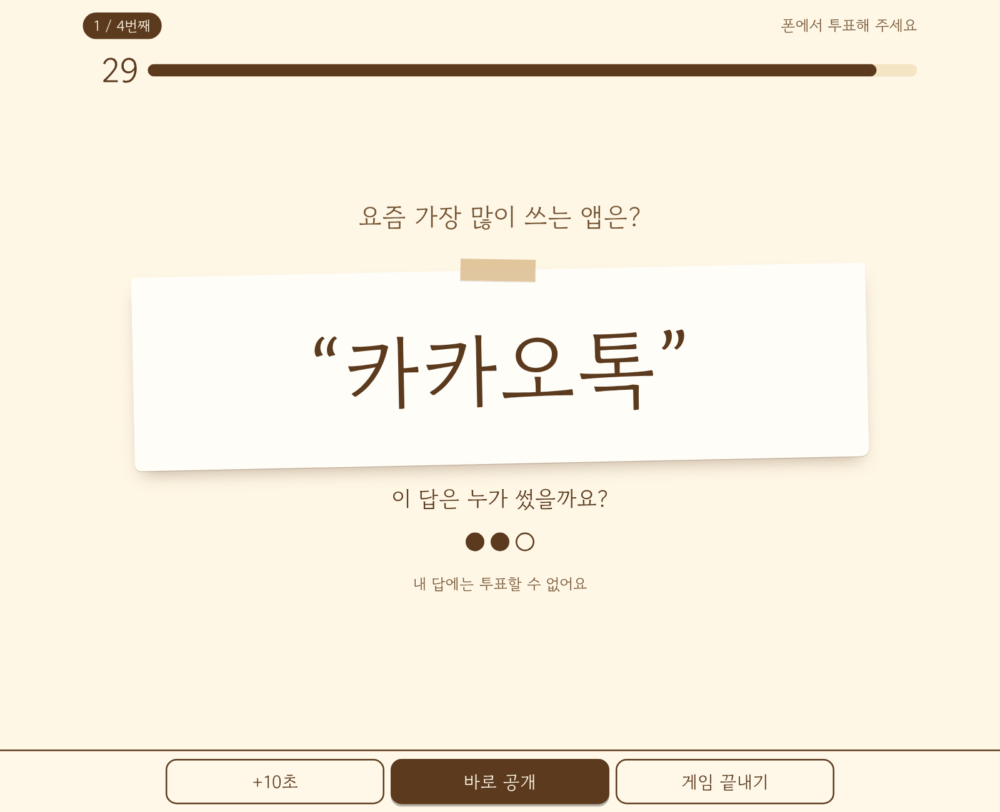
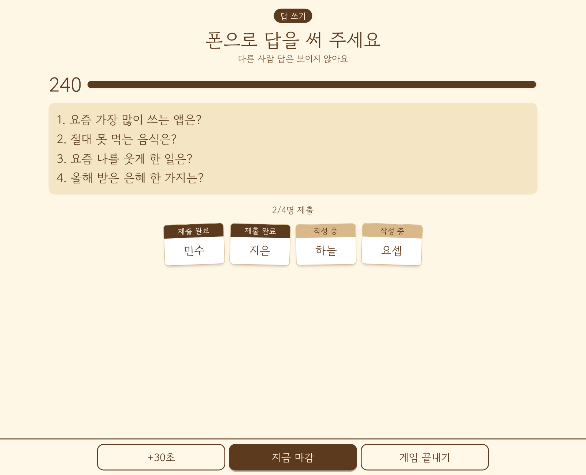
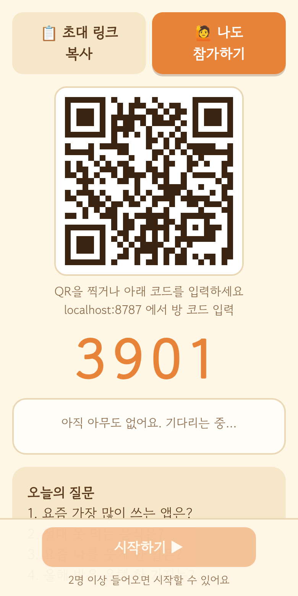
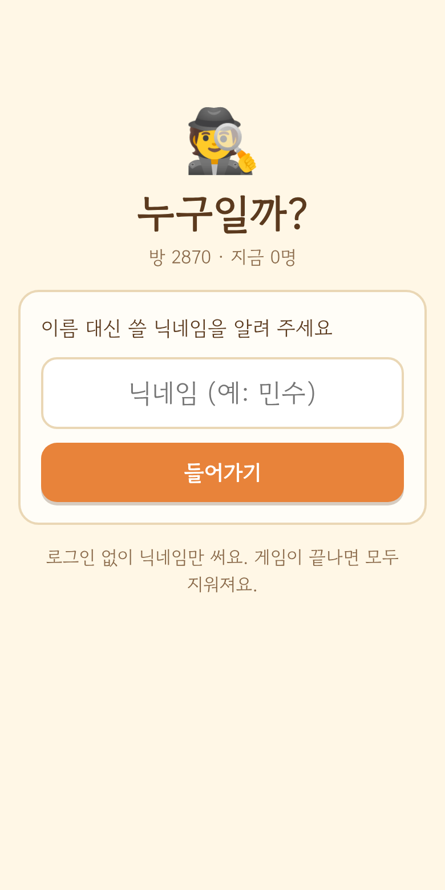
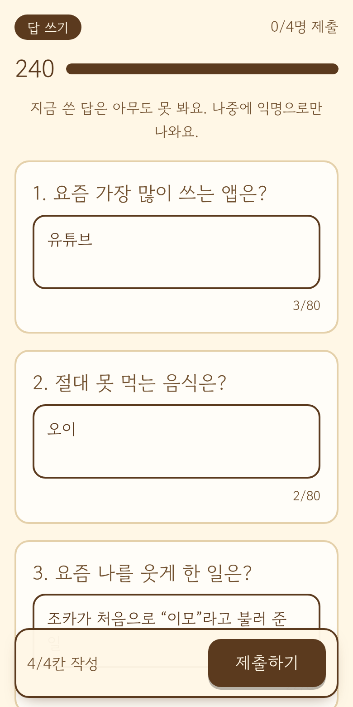
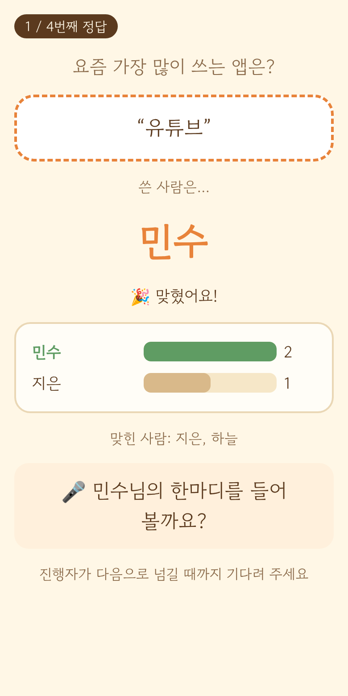
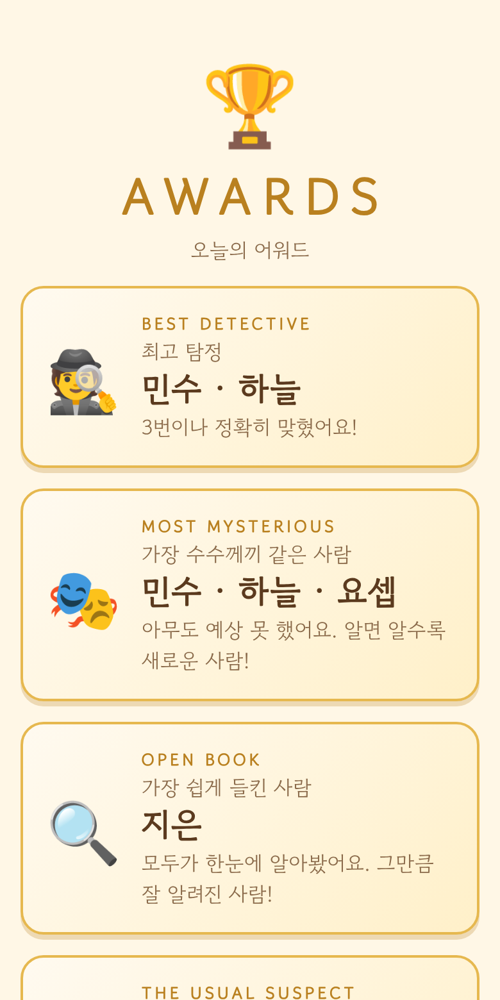
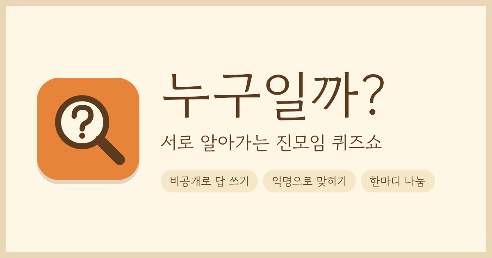

<p align="center">
  
</p>

<h1 align="center">누구일까? 퀴즈쇼</h1>

<p align="center">
  교회 청년부 소그룹(진모임, 한 모임 4~9명)이 <b>폰으로 서로 알아가는</b> 웹앱<br>
  비공개로 답 쓰기 → 익명으로 맞히기 → 한마디 나눔 → <b>AWARDS</b> 🏆
</p>

<p align="center">
  <a href="https://enssionworship-group-quiz.0191.workers.dev/host.html"><b>▶ 진행자로 방 만들기</b></a>
  ·
  <a href="https://enssionworship-group-quiz.0191.workers.dev">참가하기</a>
</p>

---

## 어떤 게임인가요?

참가자가 폰으로 방에 들어와 질문에 먼저 **비공개로 답을 쓰고**, 진행자가 답을 **하나씩 익명으로** 보여 주면 모두가 *"이 답은 누가 썼을까?"* 를 맞힙니다.
정답이 공개되면 쓴 사람이 한마디를 하고, 자연스럽게 나눔으로 이어집니다.

> 목표는 **텐션이 떨어지지 않게 빠르고 가볍게**입니다. 문제 3~5개, 총 15~20분.
> 순위표 대신 시상식 느낌의 **AWARDS**로 마무리해서, 승패로 분위기가 가라앉지 않게 했습니다.

| | |
|---|---|
| **진행자** | 방을 만들고, 질문을 고르고, 진행(다음 · 시간 추가 · 건너뛰기)을 조작합니다. 진행자도 참가자로 같이 답할 수 있어요. |
| **참가자** | 방 코드 · QR · 초대 링크로 입장해 닉네임만 쓰면 됩니다. 가입은 없습니다. |
| **동시 사용** | 방마다 완전히 독립이라 여러 모임이 같은 주소로 동시에 각자 한 판씩 할 수 있습니다. |

---

## 실제 플레이 화면

아래는 모두 **진행자 1명 + 폰 4대로 실제 한 판을 돌리며 캡처**한 화면입니다. (`npm run capture`로 다시 만들 수 있어요)
캡처 속 닉네임·답은 시연용 예시이고, 주소의 `localhost:8787`은 배포하면 실제 주소로 바뀝니다.

### 진행자 — 큰 화면

| 방 만들기 | 대기실 (QR · 방 코드) |
|:---:|:---:|
|  |  |

| 투표 중 (익명 답) | 정답 공개 |
|:---:|:---:|
|  |  |

| 답 쓰기 | AWARDS |
|:---:|:---:|
|  |  |

### 진행자 — 큰 화면 없이 폰 하나로

대기실 맨 위에 **초대 링크 복사**와 **나도 참가하기**가 있습니다. 카톡 단톡방에 링크를 붙여 넣고, 같은 탭에서 바로 참가하면 됩니다.

<p align="center"></p>

### 참가자 — 폰

| 닉네임 입력 | 답 쓰기 | 투표 | 정답 공개 |
|:---:|:---:|:---:|:---:|
|  |  |  |  |

| 제출 완료 | 내 답이 나왔을 때 (투표 불가) | 내 답이 공개됐을 때 | AWARDS |
|:---:|:---:|:---:|:---:|
|  |  |  |  |

### 아이콘 · 링크 미리보기

카톡에 링크를 올리면 아래 이미지가 미리보기로 뜨도록 설정했습니다. (`npm run icons`로 다시 만들 수 있어요)

<p align="center"></p>

---

## 게임 흐름

```
lobby ─시작─▶ writing ─(모두 제출 / 시간 종료)─▶ [ guessing ─▶ reveal ] × 문제 수 ─▶ final(AWARDS) ─▶ 방 자동 삭제
 대기실        비공개로 답 쓰기                     익명 답 투표      정답 공개·한마디       시상식
```

| 단계 | 큰 화면 | 참가자 폰 |
|---|---|---|
| **lobby** | 초대 링크 복사 · QR · 4자리 방 코드 · 입장 현황 | 닉네임 입력 → 대기 |
| **writing** | 질문 목록, 제출 현황, 타이머 | 질문 모두에 비공개로 답 쓰기 (한 칸당 80자, 비워도 됨) |
| **guessing** | 익명 답을 큰 글씨로, 투표 인원 | "누구일까?" 투표 (내 답이면 투표 불가, 바꿔 누르면 마지막 투표만 인정) |
| **reveal** | 🥁 두구두구 → 작성자 공개, 득표 분포, 맞힌 사람, "한마디" 안내 | 정답 · 득표 분포 |
| **final** | 🏆 AWARDS — 어워드가 하나씩 차례로 등장 | 어워드 + 오늘 나온 이야기 모아 보기 |

**AWARDS 종류**

| 어워드 | 받는 사람 |
|---|---|
| 🕵️ BEST DETECTIVE · 최고 탐정 | 가장 많이 맞힌 사람 |
| 🎭 MOST MYSTERIOUS · 가장 수수께끼 같은 사람 | 가장 못 맞힘(들키지 않음) |
| 🔍 OPEN BOOK · 가장 쉽게 들킨 사람 | 가장 잘 맞힘(바로 들킴) |
| 🙋 THE USUAL SUSPECT · 다들 너인 줄 알았어 | 내 답이 아닌데도 가장 많이 지목받은 사람 |

해당자가 없으면 그 어워드는 나오지 않습니다. 순위표는 만들지 않았어요.

**진행 시간 예시 (4문항, 4명)**: 입장·설명 3분 + 답 쓰기 3~4분 + 문제 4개 × (투표 30초 이내 + 한마디 1분) 8분 + 어워드 2분 = **약 16~17분**

---

## 카카오톡으로 진행하기 (전원 폰)

큰 화면이 없어도 됩니다. 진행자 폰 하나와 단톡방이면 충분합니다.

1. 진행자가 폰으로 배포 주소의 **`/host.html`** 을 엽니다.
2. 질문을 고르고 **방 만들기**를 누릅니다.
3. 대기실 맨 위 **📋 초대 링크 복사** → 단톡방에 붙여 넣기. (**📤 공유하기** 버튼이 보이는 폰에서는 바로 공유할 수도 있어요)
4. 진행자도 **🙋 나도 참가하기**를 눌러 **같은 탭에서** 닉네임을 쓰고 참가합니다. 이 화면 아래에 진행 조작 버튼이 같이 있어서, 탭 하나로 참가와 진행을 모두 합니다.
5. 참가자가 모이면 **시작하기**. 이후엔 아래 버튼만 누르면 됩니다.

| 단계 | 하단 버튼 |
|---|---|
| 답 쓰기 | `+30초` · `지금 마감` |
| 투표 | `+10초` · `바로 공개` |
| 정답 공개 | `다음 문제` (마지막은 `결과 보기`) |
| 어워드 | `방 닫고 데이터 지우기` |

- 참가 화면 위쪽의 **🖥 진행자 화면 보기**로 큰 화면 보기로 돌아올 수 있습니다.
- 노트북·TV 같은 **큰 화면이 있으면** 거기서 `/host.html`을 열고, 진행자는 자기 폰으로 참가하세요. 대기실의 `📱 다른 기기(폰)에서 조작하기` QR로 폰을 조작 패널로 쓸 수도 있습니다. ⚠️ 이 QR은 **진행자 권한**을 주므로 참가자에게 보여 주지 마세요.
- 진행 팁: 정답이 공개되면 **쓴 사람에게 한마디**를 시켜 보세요. 화면에도 안내가 뜹니다. 여기서 나눔이 시작됩니다.

### 끊겨도 이어지는 방법

| 상황 | 동작 |
|---|---|
| 새로고침 · 폰 화면 꺼짐 · 잠깐 끊김 | 저장된 참가자 토큰으로 **같은 사람으로 자동 복귀**. 쓰던 답과 낸 투표도 그대로 |
| 연결이 끊기면 | 화면 위에 "연결이 끊겼어요. 다시 연결하는 중이에요…" 안내 후 자동 재연결 |
| 저장 정보가 사라진 경우 (인앱 브라우저 등) | **같은 닉네임으로 다시 입장**하면 이어서 참가. 단, 그 닉네임의 **이전 연결이 끊긴 상태일 때만** 가능 |

- 이전 연결이 아직 살아 있으면 "같은 닉네임으로 참가 중인 사람이 있어요" 안내가 뜹니다. 보통은 이전 화면을 닫으면 바로 풀리지만, 폰이 **갑자기** 끊겼다면 서버가 알아채는 데 **30초~1분 정도** 걸릴 수 있어요. 잠시 뒤 다시 누르거나 다른 닉네임을 쓰세요. (로컬 시험에서 갑자기 끊은 경우 약 30초 걸렸습니다)
- 이어받으면 **이전 토큰은 즉시 무효**가 됩니다.
- 접속이 끊긴 사람의 투표도 기다리기 때문에, 한 명이 나가 있으면 자동 공개가 안 되고 시간이 끝날 때까지 기다리게 됩니다. 그럴 땐 `바로 공개`를 누르세요. (끊긴 사람을 건너뛰게 하면 투표 수만 보고 작성자를 추리할 수 있어서, 익명성을 위해 일부러 그렇게 두었습니다)

---

## 구조 · 기술 스택

- **Cloudflare Worker 1개** + Static Assets(화면) + **방마다 Durable Object 1개(SQLite 기반)**
- 실시간은 **WebSocket (Hibernation API)** — 아무도 말하지 않을 때는 메모리에서 내려가 비용이 들지 않음
- 화면은 프레임워크 없이 **순수 HTML/CSS/JS** (빌드 도구 없음). 글자색 `#5B3A1E`, 배경 `#FFF7E6`, 한글 웹폰트 Gowun Dodum
- 무료 요금제에서 동작하도록 설계: 정적 파일은 Worker 요청에 포함되지 않고, 입장·끊김 알림은 대기실·답 쓰기 단계에서만 전체에 전송

```
public/                  화면 (그대로 배포됨)
  index.html             첫 화면 (방 코드 입력 / 진행자로 방 만들기)
  host.html, host.js     진행자 큰 화면 + 하단 조작 패널
  play.html, play.js     참가자 폰 화면 (진행자가 참가할 때는 조작 버튼도 함께)
  common.css, common.js  공통 스타일 · 연결 · 타이머 · 초대 링크 · 어워드 화면
  questions.json         ⭐ 질문 프리셋 (여기만 고치면 됨)
  favicon.svg, *.png     아이콘 · 홈 화면 아이콘 · 링크 미리보기 이미지(og-image.png)
  manifest.webmanifest   홈 화면에 추가할 때의 이름·아이콘
  vendor/qrcode.mjs      QR 생성 (MIT, 외부 서버 호출 없음)
src/
  index.js               라우팅: 방 만들기 API, 방 확인 API, /ws/<코드>, 정적 화면
  room.js                Durable Object: 메시지 처리, 저장, 타이머, 자동 삭제, 연결·속도 제한
  game.js                순수 게임 규칙 (DO와 분리 → 컴퓨터에서 단위 테스트)
test/
  game.test.js           규칙 단위 테스트 (39개)
  e2e.mjs                실행 중인 서버에 WebSocket 으로 한 판 진행 (15개 항목)
scripts/
  capture.cjs            README 용 화면 캡처 (Playwright)
  make-icons.cjs         아이콘 · 링크 미리보기 이미지 생성 (Playwright)
wrangler.toml            assets · ROOM(Durable Object) · SQLite 마이그레이션
```

### 보안·정확성 원칙 (그리고 어떻게 확인했는지)

| 원칙 | 구현 | 확인 |
|---|---|---|
| 정답 작성자는 **reveal 전에 서버가 절대 보내지 않음** (화면에서 숨기는 방식 아님) | `viewFor()`가 단계별로 보낼 데이터만 만들어 냄 | 단위 테스트: 작성자만 다른 두 게임에서 **다른 참가자가 받는 데이터가 글자 하나까지 같음**을 비교, 일부러 유출 버그를 넣어 테스트가 잡는지 확인. 통합 테스트: 서버가 실제로 보낸 원본 메시지에 `author`·토큰 없음 (로컬·배포 환경 모두) |
| 상태 변경은 DO 안에서 **순서대로** 처리 | 메시지 처리 코드가 `await` 없이 동기적으로 끝남 | 제출·투표 순서를 30가지로 섞고 중복 요청을 넣어도 점수가 같음 |
| 진행자 권한은 **방 생성 때 발급한 토큰**으로만 | 신원(참가자 id, 진행자 여부)은 연결에 저장된 값만 사용, 클라이언트가 보낸 값은 무시 | 참가자·가짜 토큰의 시작·설정 변경이 모두 거절됨 |
| 최대 30명, 닉네임 12자, 답 80자, 닉네임 중복 방지 | `game.js` | 단위 테스트 |
| 새로고침·끊김 후 **같은 사람으로 복귀** | 참가자 토큰(localStorage) + 자동 재연결 + 닉네임 이어하기 | 단위·통합 테스트, 폰 크기 화면 시험 |
| 한 방의 폭주가 다른 방에 영향 없게 | 방당 연결 80개 상한, 연결당 10초에 40개 메시지 상한(넘으면 무시·안내, 200개 넘으면 끊음) | 통합 테스트: 빠르게 60개 보내면 제한 안내, 다른 사람 화면은 그대로 |
| 게임이 끝나면 **방과 모든 답 삭제** | 종료 30분 뒤 / 방치 3시간 뒤 alarm으로 삭제, 진행자가 즉시 삭제도 가능 | 즉시 삭제는 배포 환경에서 확인. 알람 만료 삭제는 아래 "확인하지 못한 것" 참고 |

---

## 로컬에서 실행

```bash
npm install
npm run dev
```

브라우저에서 `http://localhost:8787/host.html` 을 열면 진행자 화면입니다. (Cloudflare 계정 없이 동작)

같은 Wi-Fi의 폰으로 시험하려면 서버를 외부에서 접속 가능하게 열고, 큰 화면도 **PC의 IP 주소**로 여세요. (QR · 초대 링크에 들어가는 주소가 그 주소가 됩니다)

```bash
npx wrangler dev --ip 0.0.0.0
```

```
http://<PC의 IP>:8787/host.html
```

테스트:

```bash
npm test          # 게임 규칙 단위 테스트 39개 (서버 불필요)
npm run e2e       # 통합 테스트 15개 항목 (npm run dev 가 켜져 있어야 함)
npm run capture   # README 용 화면 캡처 갱신 (npm run dev 가 켜져 있어야 함)
npm run icons     # 아이콘 · 링크 미리보기 이미지 다시 만들기
```

배포한 주소로 통합 테스트를 돌리려면:

```bash
BASE=https://enssionworship-group-quiz.0191.workers.dev npm run e2e
```

---

## 배포 방법

Worker를 미리 만들어 둘 필요는 없습니다. 처음 배포할 때 Worker와 Durable Object가 함께 만들어집니다. (`wrangler.toml`의 `new_sqlite_classes` 마이그레이션이 무료 요금제에서 쓸 수 있는 SQLite 방식으로 생성합니다.)

### 방법 A — Cloudflare Workers Builds (GitHub 연결, 푸시하면 자동 배포) ← 현재 사용 중

1. Cloudflare 대시보드 → **Workers & Pages** → **Create** → **Import a repository** 로 이 GitHub 저장소를 연결
2. Worker 이름은 `wrangler.toml`의 `name`(`enssionworship-group-quiz`)과 **같아야** 합니다. 다르면 빌드가 실패합니다.
3. Production branch는 `main`, 빌드 명령은 비우고(빌드 도구 없음), 배포 명령은 기본값 `npx wrangler deploy`
4. 이후 `main`에 푸시하면 자동으로 배포됩니다.

> 대시보드 화면 이름은 Cloudflare 개편으로 달라질 수 있어요. 안 보이면 공식 문서의 *Workers Builds* 항목을 확인하세요.

### 방법 B — `wrangler deploy`

```bash
npm install
npx wrangler login      # 브라우저에서 Cloudflare 로그인 (처음 한 번)
npm run deploy
```

### 주소를 바꾸면 (사용자 지정 도메인 등)

각 `public/*.html`의 `og:image` 주소(링크 미리보기 이미지)는 **절대 주소**여야 해서 현재 배포 주소가 적혀 있습니다. 도메인을 바꾸면 이 주소도 함께 바꿔 주세요. (안 바꿔도 게임은 동작하고, 카톡 미리보기 이미지만 안 뜹니다)

### 기존 진모임연구소 사이트와 연결

기존 사이트는 수정하지 않습니다. 이달의 활동 페이지에 **배포된 주소 링크(또는 그 주소의 QR)** 만 걸어 두세요.

---

## 질문 프리셋 수정 방법

**`public/questions.json` 한 파일만 고치면 됩니다.** 코드는 건드리지 않아도 돼요.

```json
{
  "levels": { "light": "가벼움", "middle": "중간", "deep": "깊음" },
  "questions": [
    { "id": "app", "level": "light", "text": "요즘 가장 많이 쓰는 앱은?" },
    { "id": "myq", "level": "middle", "text": "여기에 새 질문을 추가하세요" }
  ],
  "defaultSet": ["app", "food", "laugh", "grace"]
}
```

| 항목 | 규칙 |
|---|---|
| `id` | 영문·숫자·`_`·`-`, 20자 이내, **서로 겹치지 않게** |
| `level` | `light`(가벼움) / `middle`(중간) / `deep`(깊음) |
| `text` | 60자 이내 |
| `defaultSet` | 기본으로 체크될 질문 `id` 목록 (최대 5개, 권장: 가벼움 2 + 중간 1 + 깊음 1) |

수정 후 `npm test`를 돌리면 형식과 기본 구성이 맞는지 확인해 줍니다. 그다음 `main`에 푸시하면 배포됩니다.
방을 만들 때 화면에서 **직접 질문을 추가**하는 건 파일을 고치지 않아도 됩니다. (그 방에서만 쓰임)

---

## 폰 시험 체크리스트 (배포 후 확인 항목)

**진행자 폰 1대 + 참가자 폰 2대 이상**(가능하면 카카오톡 링크로 입장)으로 확인해 주세요.

**기본 진행**
- [ ] 단톡방에 붙여 넣은 **초대 링크**를 눌러 한 방에 들어온다 (카톡 인앱 브라우저)
- [ ] 진행자가 **같은 탭에서 참가**해 조작 버튼으로 시작한다
- [ ] 같은 닉네임으로 들어가면 안내 문구가 뜬다
- [ ] 모두 제출하면 자동으로 투표 단계로 넘어간다
- [ ] 문제마다 투표 → 정답 공개 → 다음 문제가 끝까지 진행되고 **AWARDS**가 뜬다
- [ ] 단톡방에 링크를 올렸을 때 **미리보기 이미지·제목**이 뜬다

**익명성**
- [ ] 투표 중 내 폰의 개발자 도구(네트워크 → WS)에 작성자 이름이 보이지 않는다
- [ ] 내 답이 나온 문제에서는 투표 버튼이 없다

**복귀**
- [ ] 답 쓰는 도중 새로고침해도 같은 사람으로 돌아온다
- [ ] 투표 중 폰 화면을 껐다 켜도(10~20초) 게임이 이어지고 내 투표가 유지된다
- [ ] 카톡 인앱 브라우저를 닫았다가 링크를 다시 눌러 **같은 닉네임으로 이어서 참가**된다
- [ ] 닉네임을 쓰는 도중 다른 사람이 들어와도 쓰던 글자가 지워지지 않는다

**삭제**
- [ ] `방 닫고 데이터 지우기`를 누르면 참가자 폰에 안내가 뜨고, 같은 코드로 다시 들어가면 "없는 방"이 뜬다
- [ ] 게임이 끝난 방을 30분 두면 같은 코드로 들어갈 수 없다 (알람 삭제)

**진행자 조작**
- [ ] `+30초` / `지금 마감` / `바로 공개` / `다음 문제`가 동작한다
- [ ] 참가자 폰에는 조작 버튼이 보이지 않는다

**여러 모임 동시 사용**
- [ ] 두 모임이 동시에 각자 방을 만들어 진행해도 서로 섞이지 않는다

---

## 데이터와 개인정보

- 저장하는 것: 방 코드, 닉네임, 이번 판에 **공개될 답**, 투표. **가입·이메일·명단은 저장하지 않습니다.**
- 공개되지 않을 답은 답 쓰기가 끝나는 즉시 서버에서도 지웁니다.
- 방과 모든 데이터는 **게임 종료 30분 뒤**, 또는 **아무 활동 없이 3시간 뒤** 자동 삭제됩니다. (진행자가 바로 지울 수도 있어요)
- 서버에 접속 기록(로그)을 따로 남기지 않습니다.
- 브라우저(`localStorage`)에는 이 방에서만 쓰는 참가자/진행자 토큰이 남습니다. 서버 데이터가 삭제되면 쓸모가 없어집니다.
- 웹폰트(Gowun Dodum)는 Google Fonts에서 불러옵니다. 연결이 안 되면 기기 기본 한글 폰트로 보입니다.

---

## 확인한 것과 확인하지 못한 것

| 항목 | 상태 |
|---|---|
| 단위 테스트 39개 | 통과 |
| 로컬 서버 통합 테스트 15개 항목 | 통과 |
| 배포 환경 통합 테스트 | 통과 (방 만들기, 입장, 한 판 진행, 재접속, 알람 타이머, 방 삭제). 모임 두 개를 **동시에** 돌려도 각각 통과 |
| 폰 크기 화면 시험 (가상 폰, 카톡 인앱 브라우저 접속 정보 흉내) | 초대 링크 복사, 같은 탭 참가, 진행자 화면 오가기, 닉네임 이어하기, 가로 스크롤 없음 확인 |
| **실제 카카오톡 인앱 브라우저 · iOS 사파리** | **아직 확인하지 못함.** 저장소 유지, 화면 꺼짐 후 복귀, 링크 미리보기는 실제 폰에서 확인 필요 |
| **실제 폰 여러 대로 한 판** | 아직 하지 않음 (자동 시험은 가상 폰으로 진행) |
| Hibernation(방이 메모리에서 내려갔다 깨어남) | 통합 테스트는 몇 분 안에 끝나서 재현되지 않음. 상태는 저장소에서 다시 읽도록 만들었지만 **한참 쉬었다 이어 하는 시험이 필요** |
| 알람에 의한 만료 삭제(종료 30분 / 방치 3시간) | 기다릴 수 없어 실행해 보지 못함. 만료 계산은 단위 테스트, 삭제 동작은 즉시 삭제로 확인 |
| 무료 요금제 한도 | 실제 사용량을 측정하지 않음. 모임 10팀 이하 규모는 넉넉할 것으로 **추정** |
| 방 만들기 횟수 제한 | 없음 (같은 출처 요청만 허용). 필요하면 추가 |

**알아 둘 점**
- 문제마다 답 하나만 공개하고 아직 안 뽑힌 사람을 우선 고르므로, 기본 4문항이면 **4명만 주인공**이 됩니다. 라운드 수는 서버 설정으로 최대 12까지 늘릴 수 있지만 방 만들기 화면에는 아직 없습니다.
- 방 코드는 4자리라서 다른 모임의 코드를 잘못 입력하면 그 방에 들어갈 수 있습니다. 동시에 열린 방이 10개 안팎이면 확률은 매우 낮지만, 모임이 크게 늘면 6자리로 늘리는 것을 권합니다.

## 라이선스 · 출처

- QR 생성: [qrcode-generator](https://github.com/kazuhikoarase/qrcode-generator) (MIT) — `public/vendor/qrcode.mjs`
- 폰트: Gowun Dodum (SIL OFL)
- 아이콘 · 링크 미리보기 이미지: 이 프로젝트에서 직접 그린 SVG(`public/favicon.svg`)를 바탕으로 생성
