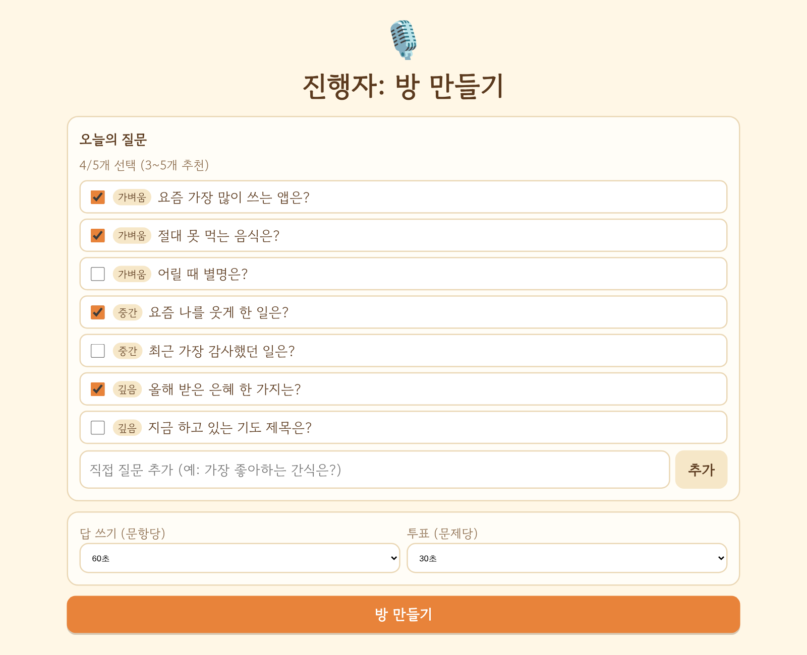
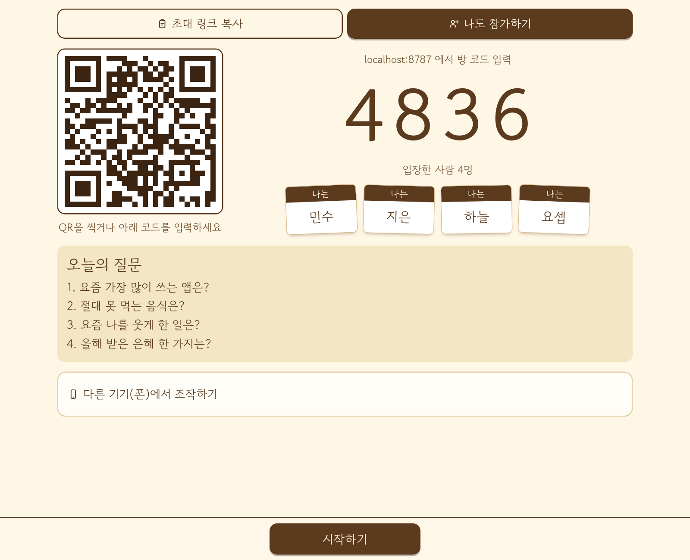
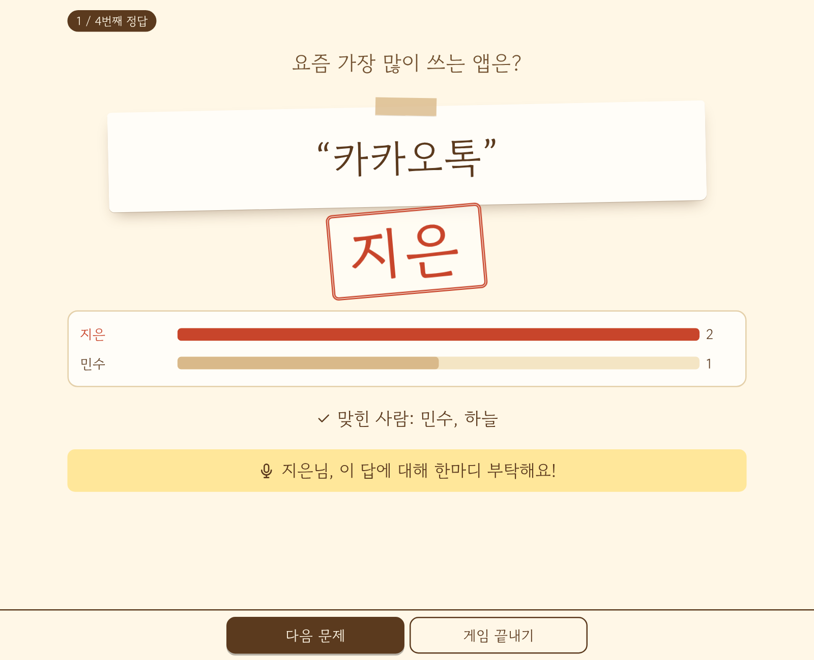
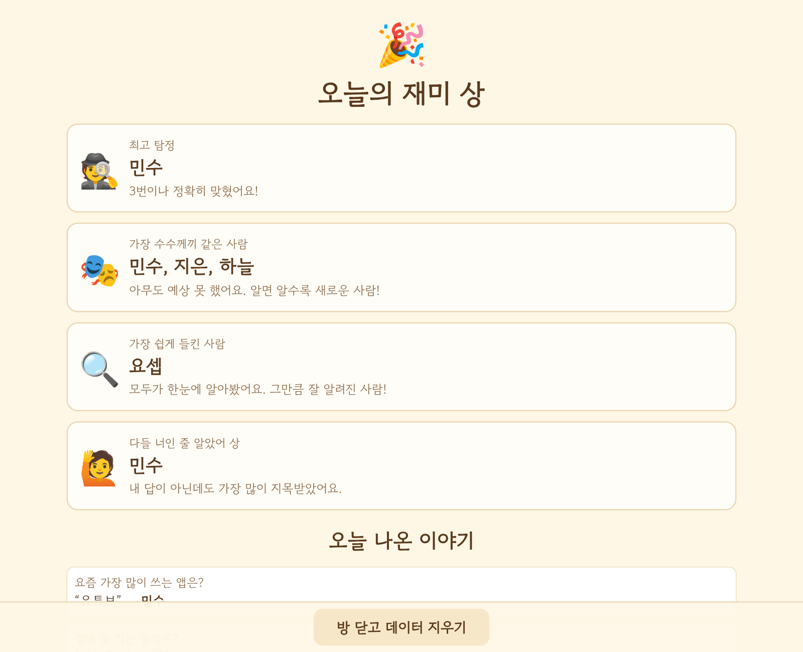
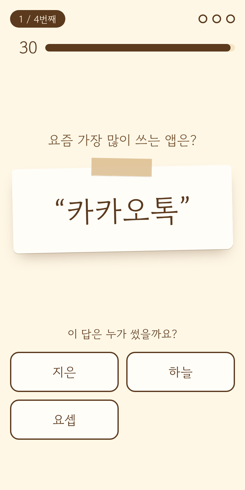
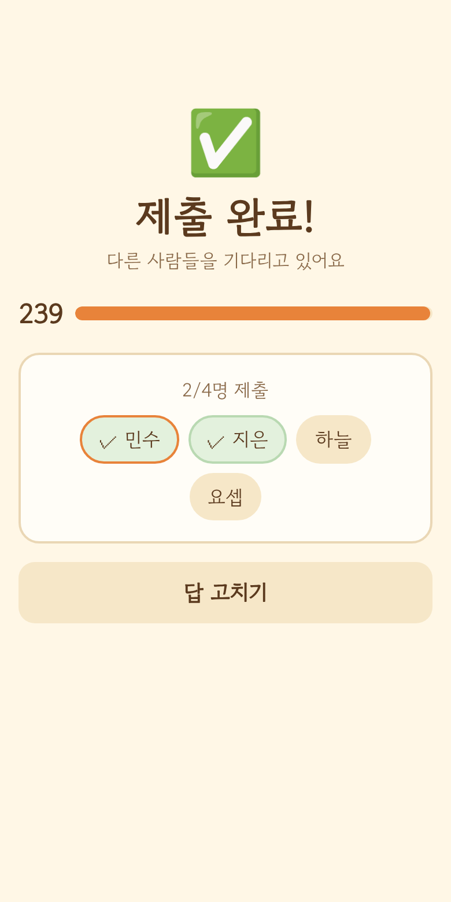
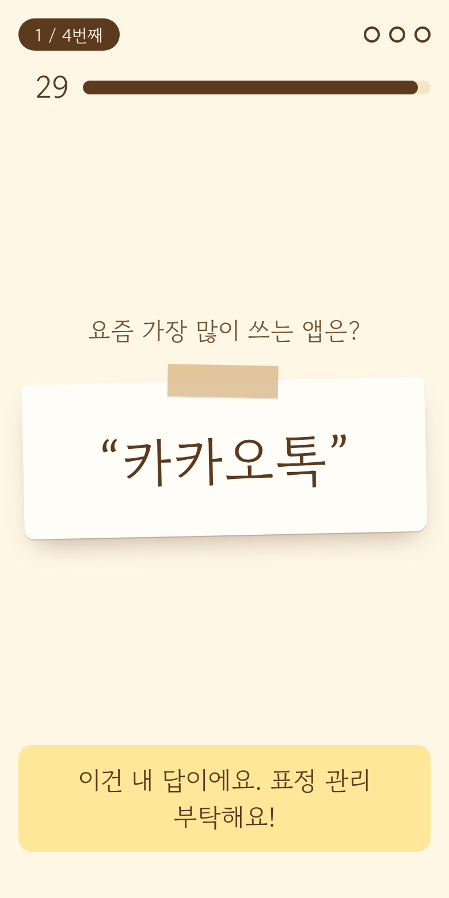
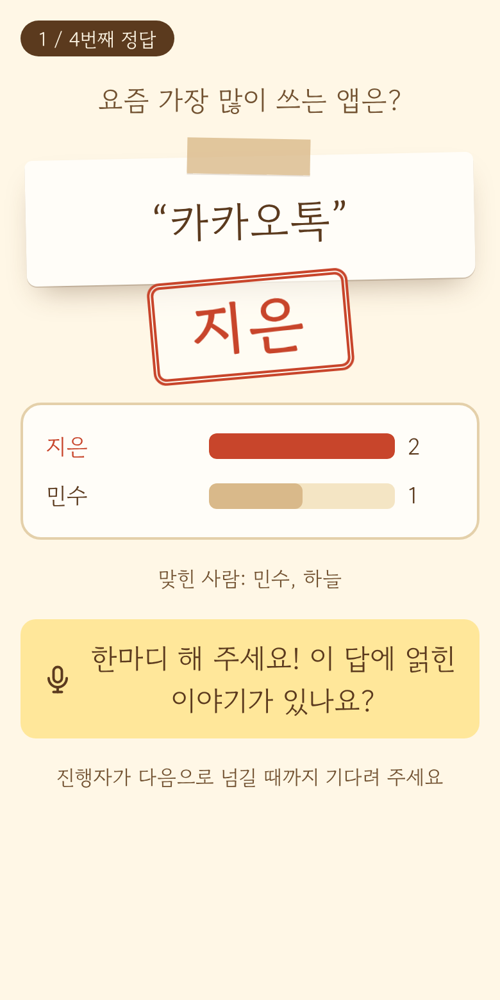

# 🕵️ 누구일까? 퀴즈쇼 (jin-quiz)

교회 청년부 소그룹 모임(진모임, 한 모임 4~9명)에서 쓰는 **"서로 알아가는 퀴즈쇼"** 웹앱입니다.

참가자가 폰으로 방에 들어와 질문에 먼저 **비공개로 답을 쓰고**, 진행자가 답을 **하나씩 익명으로** 보여 주면 모두가 *"이 답은 누가 썼을까?"* 를 맞힙니다.
정답이 공개되면 쓴 사람이 한마디를 하고, 자연스럽게 나눔으로 이어집니다.

> 목표: **텐션이 떨어지지 않게 빠르고 가볍게.** 문제 3~5개, 총 15~20분.
> 승패보다 "재미 상"으로 마무리해서 분위기가 가라앉지 않게 만들었습니다.

---

## 📸 실제 플레이 화면

아래 화면은 모두 **로컬 서버에서 진행자 1명 + 폰 4대로 실제 한 판을 돌리며 캡처**한 것입니다. (`npm run capture`로 다시 만들 수 있어요)

### 진행자 화면 (큰 화면 · 조작 패널)

| 방 만들기 | 대기실 (QR · 방 코드) |
|:---:|:---:|
|  |  |

| 투표 중 (익명 답) | 정답 공개 |
|:---:|:---:|
|  |  |

| 답 쓰기 | 최종 재미 상 |
|:---:|:---:|
|  |  |

### 참가자 화면 (폰)

| 닉네임 입력 | 답 쓰기 | 투표 | 정답 공개 |
|:---:|:---:|:---:|:---:|
|  |  |  |  |

| 제출 완료 | 내 답이 나왔을 때 (투표 불가) | 내 답이 공개됐을 때 | 재미 상 |
|:---:|:---:|:---:|:---:|
|  |  |  |  |

> 캡처 속 닉네임·답은 시연용 예시입니다. 진행자 화면 대기실의 `localhost:8787`은 배포하면 실제 주소로 바뀝니다.

---

## 🎮 게임 흐름

```
lobby ──시작──▶ writing ──(모두 제출 / 시간 종료)──▶ [ guessing ──▶ reveal ] × 문제 수 ──▶ final ──▶ 방 자동 삭제
 대기실          비공개로 답 쓰기                      익명 답 투표      정답 공개·한마디        재미 상
```

| 단계 | 진행자 큰 화면 | 참가자 폰 |
|---|---|---|
| **lobby** | QR + 4자리 방 코드, 입장 현황 | 닉네임 입력 → 대기 |
| **writing** | 질문 목록, 제출 현황, 타이머 | 질문 모두에 비공개로 답 쓰기 (한 칸당 80자) |
| **guessing** | 익명 답을 큰 글씨로, 투표 인원 | "누구일까?" 투표 (내 답이면 투표 불가) |
| **reveal** | 🥁 두구두구 → 작성자 공개, 득표 분포, 맞힌 사람, "한마디" 안내 | 정답 · 득표 분포 |
| **final** | 재미 상 (🕵️ 최고 탐정 · 🎭 가장 수수께끼 같은 사람 · 🔍 가장 쉽게 들킨 사람 · 🙋 다들 너인 줄 알았어 상) | 재미 상 + 오늘 나온 이야기 모아 보기 |

순위표는 만들지 않았습니다. 승패로 분위기가 가라앉지 않게 "상" 위주로 보여 줍니다.

### ⏱ 진행 시간 예시 (4문항, 4명 기준)

| 구간 | 시간 |
|---|---|
| 입장 · 설명 | 약 3분 |
| 답 쓰기 (모두 제출하면 바로 종료) | 3~4분 |
| 문제 4개 × (투표 30초 이내 + 한마디 1분) | 약 8분 |
| 재미 상 · 마무리 | 약 2분 |
| **합계** | **약 16~17분** |

---

## 🏗 구조 · 기술 스택

- **Cloudflare Worker 1개** + Static Assets(화면) + **방마다 Durable Object 1개(SQLite 기반)**
- 실시간 통신은 **WebSocket (Hibernation API)** — 아무도 말하지 않을 때는 메모리에서 내려가 비용이 들지 않음
- 화면은 프레임워크 없이 **순수 HTML/CSS/JS** (빌드 도구 없음). 한글 웹폰트 Gowun Dodum
- 무료 요금제에서 동작하도록 설계: 정적 파일은 Worker 요청에 포함되지 않고, 입장·끊김 알림은 필요한 단계에서만 전체 전송

```
public/                 화면 (그대로 배포됨)
  index.html            첫 화면 (방 코드 입력 / 진행자로 방 만들기)
  host.html, host.js    진행자 큰 화면 + 하단 조작 패널
  play.html, play.js    참가자 폰 화면
  common.css, common.js 공통 스타일·연결·타이머
  questions.json        ⭐ 질문 프리셋 (여기만 고치면 됨)
  vendor/qrcode.mjs     QR 생성 (MIT, 외부 서버 호출 없음)
src/
  index.js              라우팅: 방 만들기 API, /ws/<코드>, 정적 화면
  room.js               Durable Object: 메시지 처리, 저장, 타이머, 자동 삭제
  game.js               순수 게임 규칙 (DO와 분리 → 컴퓨터에서 단위 테스트)
test/
  game.test.js          규칙 단위 테스트 (34개)
  e2e.mjs               실행 중인 서버에 WebSocket 으로 한 판 진행 (13개 항목)
scripts/capture.cjs     README 용 화면 캡처 (Playwright)
wrangler.toml           assets · ROOM(Durable Object) · SQLite 마이그레이션
```

### 🔒 보안·정확성 원칙 (그리고 어떻게 확인했는지)

| 원칙 | 구현 | 확인 |
|---|---|---|
| 정답 작성자는 **reveal 전에 서버가 절대 보내지 않음** (화면에서 숨기는 방식 아님) | `viewFor()`가 단계별로 보낼 데이터만 만들어 냄 | 단위 테스트: 작성자만 다른 두 게임에서 **다른 참가자가 받는 데이터가 글자 하나까지 같음**을 비교 + 일부러 유출 버그를 넣어 테스트가 잡는지 확인. 통합 테스트: 서버가 실제로 보낸 원본 메시지에 `author`·토큰이 없음 |
| 상태 변경은 DO 안에서 **순서대로** 처리 | 메시지 처리 코드가 `await` 없이 동기적으로 끝남 | 제출·투표 순서를 30가지로 섞고 중복 요청을 넣어도 점수가 같음 |
| 진행자 권한은 **방 생성 때 발급한 토큰**으로만 | 신원(참가자 id, 진행자 여부)은 연결에 저장된 값만 사용, 클라이언트가 보낸 값은 무시 | 참가자·가짜 토큰의 시작·설정 변경이 모두 거절됨 |
| 최대 30명, 닉네임 12자, 답 80자, 닉네임 중복 방지 | `game.js` | 단위 테스트 |
| 새로고침·끊김 후 **같은 사람으로 복귀** | 참가자 토큰(localStorage) + 자동 재연결 | 연결을 끊었다 토큰으로 복귀, 쓰던 답·투표 유지 |
| 게임이 끝나면 **방과 모든 답 삭제** | 종료 30분 뒤 / 방치 3시간 뒤 alarm으로 삭제, 진행자가 즉시 삭제도 가능 | 즉시 삭제는 로컬에서 확인. 알람 만료 삭제는 아래 "아직 확인 못 한 것" 참고 |

---

## 🚀 로컬에서 실행

```bash
npm install
npm run dev
```

브라우저에서 `http://localhost:8787/host.html` 을 열면 진행자 화면입니다. (Cloudflare 계정 없이 동작)

같은 Wi-Fi의 폰으로 시험하려면 서버를 외부에서 접속 가능하게 열고, 큰 화면도 **PC의 IP 주소**로 여세요. (QR에 들어가는 주소가 그 주소가 됩니다)

```bash
npx wrangler dev --ip 0.0.0.0
```

```
http://<PC의 IP>:8787/host.html
```

테스트:

```bash
npm test          # 게임 규칙 단위 테스트 (서버 불필요)
npm run e2e       # 통합 테스트 (npm run dev 가 켜져 있어야 함)
npm run capture   # 화면 캡처 갱신 (npm run dev 가 켜져 있어야 함)
```

---

## ☁️ 배포 방법

Worker를 미리 만들어 둘 필요는 없습니다. 처음 배포할 때 Worker와 Durable Object가 함께 만들어집니다.
(`wrangler.toml`의 `new_sqlite_classes` 마이그레이션이 무료 요금제에서 쓸 수 있는 SQLite 방식으로 생성합니다.)

### 방법 A — `wrangler deploy` (가장 간단)

```bash
npm install
npx wrangler login      # 브라우저에서 Cloudflare 로그인 (처음 한 번)
npm run deploy
```

배포가 끝나면 `https://enssionworship-group-quiz.<계정 서브도메인>.workers.dev` 주소가 출력됩니다.

### 방법 B — Cloudflare Workers Builds (GitHub 연결, 푸시하면 자동 배포)

1. Cloudflare 대시보드 → **Workers & Pages** → **Create** → **Import a repository** 로 이 GitHub 저장소를 연결
2. 이름은 `wrangler.toml`의 `name`(`enssionworship-group-quiz`)과 같게 둡니다
3. 빌드 명령은 비워 두고(빌드 도구 없음), 배포 명령은 기본값 `npx wrangler deploy` 를 사용합니다
4. 이후 브랜치에 푸시하면 자동으로 배포됩니다

> 대시보드 화면 이름은 Cloudflare 개편으로 달라질 수 있어요. 안 보이면 공식 문서의 *Workers Builds* 항목을 확인하세요.

### 기존 진모임연구소 사이트와 연결

기존 사이트는 수정하지 않습니다. 이달의 활동 페이지에 **배포된 주소 링크(또는 그 주소의 QR)** 만 걸어 두세요.

---

## 🧑‍🏫 방 만들기 · 진행 방법

1. 큰 화면(노트북·TV·빔프로젝터)에서 배포 주소의 **`/host.html`** 을 엽니다.
2. 오늘의 질문을 고르고(기본: 가벼움 2 + 중간 1 + 깊음 1), 필요하면 **직접 질문을 추가**한 뒤 **방 만들기**를 누릅니다.
3. 화면에 뜬 **QR** 을 참가자가 폰으로 찍거나, 첫 화면에서 **4자리 방 코드**를 입력해 들어옵니다. 닉네임만 쓰면 되고 가입은 없습니다.
4. 2명 이상 모이면 아래 **시작하기**를 누릅니다.
5. 이후엔 아래 버튼만 누르면 됩니다.

| 단계 | 하단 버튼 |
|---|---|
| 답 쓰기 | `+30초` · `지금 마감` |
| 투표 | `+10초` · `바로 공개` |
| 정답 공개 | `다음 문제` (마지막은 `결과 보기`) |
| 결과 | `방 닫고 데이터 지우기` |

**진행 팁**
- 정답이 공개되면 **쓴 사람에게 한마디**를 시켜 보세요. 화면에도 안내가 뜹니다. 여기서 나눔이 시작됩니다.
- **진행자도 참가할 수 있어요.** 대기실의 `나도 참가하기` 를 누르거나, 진행자 폰으로 일반 참가자처럼 입장하세요. 같은 브라우저에서 방을 만들었다면 참가 화면에도 같은 조작 버튼이 뜹니다.
- **큰 화면 없이 폰 하나로도 진행**할 수 있어요. 대기실의 `📱 다른 기기(폰)에서 조작하기` QR을 다른 폰으로 찍으면 그 폰이 조작 패널이 됩니다. ⚠️ 이 QR로 들어가면 **진행자 권한**을 갖게 되니 참가자에게 보여 주지 마세요.
- 폰 화면이 꺼지거나 새로고침해도 같은 사람으로 돌아옵니다. 닉네임을 다시 쓸 필요가 없어요.

---

## ✏️ 질문 프리셋 수정 방법

**`public/questions.json` 한 파일만 고치면 됩니다.** 코드는 건드리지 않아도 돼요.

```json
{
  "levels": { "light": "가벼움", "middle": "중간", "deep": "깊음" },
  "questions": [
    { "id": "app", "level": "light", "text": "요즘 가장 많이 쓰는 앱은?" },
    { "id": "myq", "level": "middle", "text": "여기에 새 질문을 추가하세요" }
  ],
  "defaultSet": ["app", "food", "laugh", "grace"]
}
```

| 항목 | 규칙 |
|---|---|
| `id` | 영문·숫자·`_`·`-`, 20자 이내, **서로 겹치지 않게** |
| `level` | `light`(가벼움) / `middle`(중간) / `deep`(깊음) |
| `text` | 60자 이내 |
| `defaultSet` | 기본으로 체크될 질문 `id` 목록 (최대 5개, 권장: 가벼움 2 + 중간 1 + 깊음 1) |

수정 후 `npm test`를 돌리면 형식과 기본 구성이 맞는지 확인해 줍니다. 그다음 다시 배포하면 반영됩니다.
방을 만들 때 화면에서 **직접 질문을 추가**하는 건 파일을 고치지 않아도 됩니다. (그 방에서만 쓰임)

---

## ✅ 폰 3~4대 시험 체크리스트 (배포 후 확인 항목)

배포한 주소에서 **진행자 큰 화면 1대 + 폰 3대 이상**으로 확인해 주세요.

**기본 진행 (완료 조건 1)**
- [ ] 폰 3대 이상이 QR / 방 코드로 한 방에 들어온다
- [ ] 같은 닉네임으로 들어가면 안내 문구가 뜬다
- [ ] 시작 → 답 쓰기 → 모두 제출하면 자동으로 투표 단계로 넘어간다
- [ ] 문제마다 투표 → 정답 공개 → 다음 문제가 끝까지 진행되고 재미 상이 뜬다

**익명성 (완료 조건 2)**
- [ ] 투표 중 내 폰에서 개발자 도구(네트워크 → WS)를 열어도 작성자 이름이 보이지 않는다
- [ ] 내 답이 나온 문제에서는 투표 버튼이 없다

**복귀 (완료 조건 3)**
- [ ] 답 쓰는 도중 새로고침해도 같은 사람으로 돌아온다
- [ ] 투표 중 폰 화면을 껐다 켜도(10~20초) 게임이 이어지고 내 투표가 유지된다
- [ ] Wi‑Fi를 잠깐 껐다 켜면 "다시 연결하는 중" 안내 후 복구된다

**삭제 (완료 조건 4)**
- [ ] `방 닫고 데이터 지우기`를 누르면 참가자 폰에 안내가 뜨고, 같은 코드로 다시 들어가면 "없는 방"이 뜬다
- [ ] 게임이 끝난 방을 30분 두면 같은 코드로 들어갈 수 없다 (알람 삭제)

**진행자 조작**
- [ ] `+30초` / `지금 마감` / `바로 공개` / `다음 문제`가 동작한다
- [ ] 다른 폰으로 `📱 다른 기기에서 조작하기` QR을 찍어 조작할 수 있다
- [ ] 참가자 폰에는 조작 버튼이 보이지 않는다

**배포 환경에서 따로 확인할 것**
- [ ] 배포 주소로 통합 테스트 통과: `BASE=https://내주소.workers.dev npm run e2e`
- [ ] 한참 아무도 말하지 않은 뒤에도 게임이 이어진다 (Hibernation 후 복귀)

---

## 🔐 데이터와 개인정보

- 저장하는 것: 방 코드, 닉네임, 이번 판에 **공개될 답**, 투표. **가입·이메일·명단은 저장하지 않습니다.**
- 공개되지 않을 답은 답 쓰기가 끝나는 즉시 서버에서도 지웁니다.
- 방과 모든 데이터는 **게임 종료 30분 뒤**, 또는 **아무 활동 없이 3시간 뒤** 자동 삭제됩니다. (진행자가 바로 지울 수도 있어요)
- 브라우저(`localStorage`)에는 이 방에서만 쓰는 참가자/진행자 토큰이 남습니다. 서버 데이터가 삭제되면 쓸모가 없어집니다.
- 웹폰트(Gowun Dodum)는 Google Fonts에서 불러옵니다. 연결이 안 되면 기기 기본 한글 폰트로 보입니다.

## ⚠️ 제한과 아직 확인하지 못한 것

| 항목 | 상태 |
|---|---|
| 실제 Cloudflare 배포 | **완료**. 배포 주소에서 통합 테스트 13개 항목 통과 (방 만들기, 입장, 한 판 진행, 재접속, 알람 타이머, 방 삭제) |
| 폰 3대 이상 실제 기기 시험 | 아직 **하지 않음** (자동 시험은 가상 폰 4개로 진행) |
| Hibernation(방이 메모리에서 내려갔다 깨어남) | 통합 테스트는 몇 분 안에 끝나서 재현되지 않음. 상태는 저장소에서 다시 읽도록 만들었지만 **한참 쉬었다 이어 하는 시험이 필요** |
| 알람에 의한 만료 삭제(종료 30분 / 방치 3시간) | 기다릴 수 없어 실행해 보지 못함. 만료 계산은 단위 테스트, 삭제 동작은 즉시 삭제로 확인 |
| 방 만들기 횟수 제한 | 없음 (같은 출처 요청만 허용). 필요하면 추가 |
| 게임 규칙 | 문제마다 답 하나만 공개하고 아직 안 뽑힌 사람을 우선 고르므로, 기본 4문항이면 **4명만 주인공**이 됩니다. 라운드 수는 설정으로 최대 12까지 늘릴 수 있어요 (현재 방 만들기 화면에는 없음) |

## 📜 라이선스·출처

- QR 생성: [qrcode-generator](https://github.com/kazuhikoarase/qrcode-generator) (MIT) — `public/vendor/qrcode.mjs`
- 폰트: Gowun Dodum (SIL OFL)
